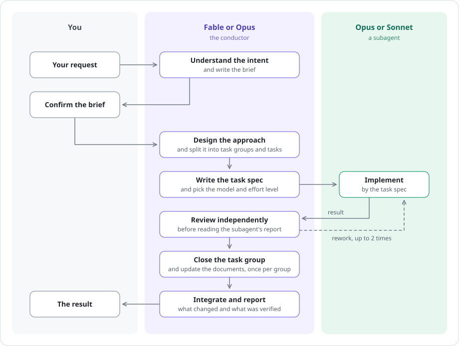

# orchestra

A Claude Code plugin that keeps Fable in the conductor role. Fable designs, delegates, and reviews independently. Opus and Sonnet subagents implement. The principles that need judgment live in the conductor's instructions. The principles that need no judgment are enforced by hooks.

Orchestra chooses the model and effort for its Opus and Sonnet subagents. You set the Fable conductor's effort yourself using the control below the prompt input. Orchestra does not change the conductor's effort.

## Objectives

Orchestra sets the model and the effort level for each piece of work by Anthropic's official prompting guides for [Fable 5.2](https://platform.claude.com/docs/en/build-with-claude/prompt-engineering/prompting-claude-fable-5-2), [Opus 5.5](https://platform.claude.com/docs/en/build-with-claude/prompt-engineering/prompting-claude-opus-5-5), and [Sonnet 5.5](https://platform.claude.com/docs/en/build-with-claude/prompt-engineering/prompting-claude-sonnet-5-5). It has two goals:

- **Cut needless token use.** No task runs on a larger model or a higher effort level than it needs.
- **Let each model do what it does best.** Fable understands what you want, designs, and reviews. Opus and Sonnet implement.

## Workflow



## Install

Requirements: Claude Code 2.1.295 or later, and `python3`.

```bash
claude plugin marketplace add paulkwongemini/orchestra
claude plugin install orchestra@orchestra
```

Or in one step:

```bash
claude plugin install orchestra --marketplace paulkwongemini/orchestra
```

Start a new session after installing. To check the environment, run `/orchestra:setup` in a session.

To try the plugin from a local copy without installing it:

```bash
claude --plugin-dir /path/to/orchestra
```

## Usage

After you install the plugin, the model of a chat decides its mode.

- **The model is Fable: conductor mode.** Fable works out what you want, delegates the implementation to subagents, and reviews their results. It does not edit your files itself.
- **The model is anything else: ordinary mode.** The plugin does nothing.

Change the model in the middle of a chat, and the mode changes with it.

Conductor mode is meant for work of some size. For a small task, switch the chat to another model and do it there.

For the Fable conductor, we recommend starting at `high`, following [Anthropic's Claude Fable 5.2 prompting guide](https://platform.claude.com/docs/en/build-with-claude/prompt-engineering/prompting-claude-fable-5-2#calibrate-effort). Choose the level to suit the work:

- **`high`**: the recommended starting point for complex coding, research, and extended autonomous work.
- **`medium`**: for interactive development and routine tasks when it maintains the quality you need with less time and fewer tokens.
- **`xhigh`**: for especially demanding, extended tasks only when your evaluations show an improvement worth the additional time and token use.

Set the conductor's effort yourself using the control below the prompt input. Orchestra does not change it.

To use Fable in ordinary mode, turn conductor mode off for that chat.

| Command | What it does |
|---|---|
| `/orchestra:disable` | Turns conductor mode off for this chat. Fable works as an ordinary session |
| `/orchestra:enable` | Turns conductor mode back on for this chat |
| `/orchestra:conductor` | Turns conductor mode back on and loads the conductor's instructions right away |
| `/orchestra:setup` | Checks the environment and lists the work folders. Changes nothing |

The commands apply to the chat you type them in. Only you can turn the mode on or off. Fable cannot do it for itself.

## What is in it

| Kind | Name | Role |
|---|---|---|
| Skill | `orchestra:conductor` | The conductor's instructions. Fable loads it at the start of a chat in conductor mode, and again after the chat is compacted or cleared. A hook refuses every other tool call until it is loaded |
| Skill | `orchestra:delegation` | The rules for choosing the subagent and the effort level of each task. Fable loads it before its first delegation, and a hook refuses a delegation until it is loaded |
| Subagent | `orchestra:opus-engineer` | Opus, effort medium. Hard implementation, complex debugging |
| Subagent | `orchestra:opus-analyst` | Opus, effort high. Architecture review, deep analysis. Read-only |
| Subagent | `orchestra:sonnet-builder` | Sonnet, effort medium. Simple code, repetitive work |
| Subagent | `orchestra:sonnet-writer` | Sonnet, effort medium. Documents whose structure is already decided |

## Principles and how each is enforced

The enforcement below applies in a conductor session.

| Principle | Enforcement | File |
|---|---|---|
| 1. Fable is the orchestrator | Instructions | `skills/conductor/SKILL.md` |
| 2. Understand the intent before working | Instructions. Implementation cannot be delegated without a brief, or before the user has replied since the brief last changed | `scripts/guard_agent.py` |
| 3. Stop and ask when an exception comes up | Instructions. Commands that change repository state, dependencies, or external services go to the user | `scripts/guard_main.py` |
| 4. Subagents use Opus or Sonnet, with model and effort chosen by the delegation rules | Agent types off the roster and `haiku` are refused. The choice between Opus and Sonnet and the effort level follow written rules (`skills/delegation/SKILL.md`), which must be loaded before a delegation | `scripts/guard_agent.py` |
| 5. No Fable subagents | Forks, `model: fable`, calls without a type, and workflows are refused | `scripts/guard_agent.py` |
| 6. Subagents do not start subagents | Subagents have no `Agent` tool. A call is refused | `agents/*.md`, `scripts/guard_agent.py` |
| 7. Review the result independently, then read the report | A `DONE` handback requires passing verification records. Reports arrive only as files. A report does not open without a review record | `scripts/check_report.py`, `scripts/report_gate.py` |
| 8. The conductor waits for delegated work instead of doing it | Instructions. The conductor's Edit, Write, and file-changing shell commands are refused. The shell check catches the common ways to change a file and sends the work back to delegation. It is not a sandbox | `skills/conductor/SKILL.md`, `scripts/guard_main.py` |
| 9. Every delegation goes through a task spec | Delegation is refused without a task spec file that has the required sections | `scripts/guard_agent.py` |
| 10. Failed work goes back to the subagent | Instructions. A reworked report needs a new review record before it opens | `scripts/report_gate.py` |

Principle 8 is about patience, not about a waiting mode. Subagents usually run in the background, and the conductor ends its turn and resumes when one of them reports. However long that takes, the conductor does not take the work back. The hooks leave it unable to change project files, so the plugin needs no extra setting for this.

## Work folder

The conductor and the subagents exchange documents through `.orchestra/` in the project. Each piece of work has its own folder there, named with the date and a short name.

```
.orchestra/
├── .gitignore                       keeps the folder out of git
└── 2026-11-12-login-fix/            one folder per piece of work
    ├── brief.md                     the intent confirmed with the user. Written by the conductor
    ├── decisions.md                 decisions made without asking. Written by the conductor
    ├── tasks/T01-session-expiry.md  task spec. Written by the conductor
    ├── reports/T01.md               report. Written by the subagent
    └── reviews/T01.md               independent review record. Written by the conductor
```

Work folders do not share anything. A brief or a review record in one folder does not count for another, and task `T01` of one piece of work has nothing to do with `T01` of the next.

The required headings of each document are under "Document formats" in `skills/conductor/SKILL.md`. The list the hooks check is in `scripts/common.py`. Change both together. Only the headings are fixed. The body of a document can be in any language.

The plugin creates `.orchestra/.gitignore` with the content `*`, so nothing in the folder reaches git by accident. To commit these records, replace the content of that file. An empty file commits everything. The plugin does not touch the file once it exists, so do not delete it, or it is created again.

The plugin never deletes a work folder. The review records are the evidence that results were checked independently. Delete finished folders yourself when you no longer need them.

## Development

How to run the tests, and what has been verified in real sessions, is in [docs/development.md](docs/development.md).
